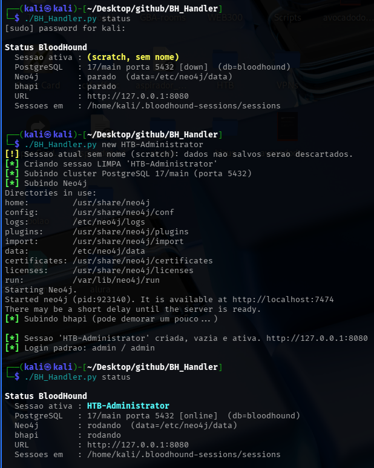
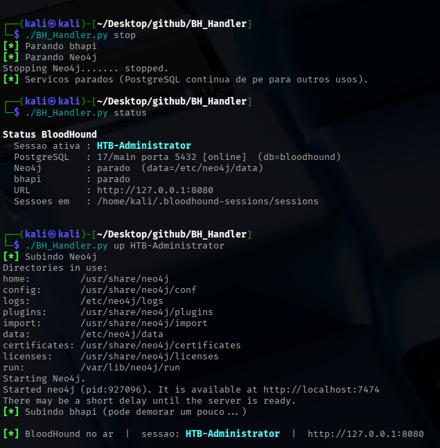
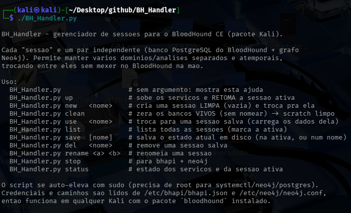

<p align="center">
  
</p>

<h1 align="center">BH_Handler</h1>

<p align="center">
  <strong>Gerenciador de sessões para o BloodHound CE — pacote Kali ou Docker Compose.</strong><br>
  Mantém vários domínios/engajamentos separados e atemporais — cada sessão é um par
  independente (banco PostgreSQL + grafo Neo4j) — e troca entre eles com um comando.
</p>

<p align="center">
  <em>Feito por <strong>Avocado</strong> · equipe <strong>Caramelo Storm</strong></em><br>
  <a href="https://www.linkedin.com/in/rafael-raugi/">💼 LinkedIn</a> ·
  <a href="https://www.youtube.com/@avocado-shell">📺 YouTube @avocado-shell</a>
</p>

---

O BloodHound CE do pacote Kali usa **um único** banco PostgreSQL + Neo4j. Ao analisar
um novo domínio você precisa **limpar tudo** e perde o anterior. O `BH_Handler` resolve
isso: cada **sessão** vira um snapshot independente (dump do PostgreSQL + tarball do
diretório de dados do Neo4j) guardado em disco. Você cria, salva, troca e retoma
engajamentos **sem mexer no BloodHound na mão** — sai de "um domínio por vez" para
"quantos engajamentos quiser, lado a lado".

> 🔒 **Privacidade:** os snapshots ficam em `~/.bloodhound-sessions/` do seu usuário
> e contêm dados coletados do cliente (usuários, grupos, ACLs do AD). **Não versione
> sessões reais** — o `.gitignore` já cobre isso. Use em máquina/rede isolada e
> expurgue (`del`) o que não precisar mais.

## O que ele faz

- **Sessões nomeadas** — cada engajamento/domínio num par PostgreSQL + Neo4j próprio.
- **Snapshot consistente** — para os serviços, faz `pg_dump -Fc` + `tar` do data dir
  do Neo4j, e devolve a posse dos arquivos ao seu usuário.
- **Troca atômica** — `use <nome>` restaura os dois bancos e religa o BloodHound.
- **Scratch** — um modo "sem nome" para análises rápidas e descartáveis.
- **Dois backends** — `local` (pacote Kali) e `docker` (docker-compose oficial da
  SpecterOps), com os mesmos comandos e o **mesmo formato de sessão**.
- **Zero hardcode** — no `local` lê `/etc/bhapi/bhapi.json` e `/etc/neo4j/neo4j.conf`;
  no `docker` lê o compose resolvido (`docker compose config`): projeto, volumes,
  usuário/banco do PostgreSQL e porta publicada.
- **Root só quando precisa** — o `local` se auto-eleva com sudo; o `docker` roda como
  seu usuário (basta estar no grupo `docker`).

## Backends

| | `local` | `docker` |
|---|---|---|
| Serviços | `pg_ctlcluster` + `neo4j` + `bhapi` | `docker compose up/stop` |
| PostgreSQL | `runuser -u postgres pg_dump/pg_restore` | `docker compose exec app-db pg_dump/pg_restore` |
| Neo4j | `tar` direto no data dir | `tar` num container descartável do `graph-db` com o mesmo volume |
| Root | sim (auto-sudo) | não |
| `stop` | para bhapi + Neo4j (PostgreSQL segue de pé) | para todos os containers (volumes preservados) |

Escolha do backend (o primeiro que existir vence):

1. Flag: `--docker`, `--local` ou `--compose-file PATH` (implica `--docker`)
2. Variáveis: `BH_BACKEND=docker|local` e `BH_COMPOSE_FILE=PATH`
3. `~/.bloodhound-sessions/config.json` — **gravado automaticamente quando você passa
   uma flag**, então basta informar uma vez
4. Auto-detecção: achou um compose com `specterops/bloodhound` (subindo a partir do
   diretório atual, em `./bloodhound/`, `~/bloodhound/` ou `~/.config/bloodhound/`)
   → `docker`; senão, pacote Kali instalado → `local`

```bash
./BH_Handler.py --compose-file ~/bloodhound/docker-compose.yml status   # 1ª vez (fica salvo)
./BH_Handler.py new acme                                                # já usa o docker
./BH_Handler.py --local up                                              # volta pro pacote Kali
```

> ⚠️ Os dois backends publicam a UI em `127.0.0.1:8080` — não rode os dois ao mesmo tempo.
> Snapshots são portáveis entre backends (mesmo `pg.dump` + `neo4j_data.tar.gz`), mas o
> restore cruzado depende das versões de PostgreSQL/Neo4j serem compatíveis.

## Como rodar

```bash
cd BH_Handler
./BH_Handler.py up              # sobe os serviços e RETOMA a sessão ativa
./BH_Handler.py new acme        # cria uma sessão LIMPA "acme" e troca pra ela
./BH_Handler.py list            # lista todas as sessões (marca a ativa)
./BH_Handler.py use cliente-x   # troca para uma sessão salva (carrega os dados)
./BH_Handler.py save            # checkpoint da sessão ativa
./BH_Handler.py status          # estado dos serviços e da sessão ativa
```
No `local` o script se auto-eleva com `sudo`; abra `http://127.0.0.1:8080`.
Login: `admin / admin` no pacote Kali. No Docker, cada banco novo (`new`/`clean`) gera
uma senha inicial aleatória — o `BH_Handler` lê dos logs do container e mostra na tela.

<p align="center">
  
  <br><sub>Subindo os serviços e checando o <code>status</code> da sessão ativa.</sub>
</p>

<p align="center">
  
  <br><sub>Ciclo <code>stop</code> → <code>status</code> → <code>up</code>: os serviços param (PostgreSQL
  segue de pé) e o <code>up</code> religa Neo4j + bhapi <strong>retomando a sessão</strong>.</sub>
</p>

## Comandos

<p align="center">
  
  <br><sub>Ajuda do BH_Handler (<code>./BH_Handler.py</code> sem argumentos ou <code>help</code>).</sub>
</p>


| Comando | Ação |
|---------|------|
| `up` (`start`) | Sobe os serviços e retoma a sessão ativa |
| `new <nome> [desc]` | Cria uma sessão **limpa** (vazia) e troca pra ela |
| `clean` (`reset`, `fresh`) | Zera os bancos vivos → scratch limpo (sem nome) |
| `use <nome>` (`switch`) | Troca para uma sessão salva (restaura os dados dela) |
| `list` (`ls`) | Lista todas as sessões (`*` = ativa) com tamanho e descrição |
| `save [nome]` | Salva o estado atual (na ativa, ou criando/usando `<nome>`) |
| `del <nome>` (`rm`) | Remove uma sessão salva |
| `rename <a> <b>` (`mv`) | Renomeia uma sessão |
| `stop` (`down`) | Para os serviços (ver tabela de backends) |
| `status` (`st`) | Backend, estado dos serviços e da sessão ativa |
| `help` | Ajuda |

## Requisitos

- Python 3 (stdlib apenas — **sem dependências externas**)
- **local:** Kali com o pacote oficial (`sudo apt install bloodhound`); binários
  `neo4j`, `pg_lsclusters`, `psql`, `runuser` no `PATH` (o script valida)
- **docker:** Docker + plugin `docker compose` v2, usuário com acesso ao daemon e o
  [docker-compose oficial](https://github.com/SpecterOps/BloodHound) (serviços
  `app-db`, `graph-db`, `bloodhound`)

## Como funciona (resumo técnico)

1. **Config real, não hardcode** — `local`: `bhapi.json` + `neo4j.conf`; `docker`:
   `docker compose config --format json`. Os defaults no código são só fallback.
2. **Salvar** — para BloodHound + Neo4j (PostgreSQL fica no ar), `pg_dump -Fc` do banco
   e `tar czf` do data dir do Neo4j em `~/.bloodhound-sessions/sessions/<nome>/`,
   com `meta.json`. No Docker o `tar` roda em `docker compose run --rm graph-db`,
   que monta o mesmo volume.
3. **Restaurar** — dropa/recria o banco e faz `pg_restore --no-owner`, extrai o tarball
   do Neo4j (preservando dono) e religa os serviços.
4. **Limpar** — recria o banco vazio e remove só o grafo `neo4j`, **preservando** o db
   `system` do Neo4j (mantém a autenticação) — o BloodHound re-migra o schema no boot.

## Estrutura
```
BH_Handler.py     o gerenciador (Python 3, stdlib; backends local e docker)
caramelo.jpeg     logo da equipe
~/.bloodhound-sessions/        (criado em runtime; NÃO versionado)
  ├── active                   nome da sessão ativa
  ├── config.json              backend + compose escolhidos via flag
  ├── sessions/<nome>/         pg.dump + neo4j_data.tar.gz + meta.json
  └── logs/bhapi.log
```

## Aviso

Ferramenta de apoio a **operações ofensivas autorizadas**. O BloodHound e os dados
que ele coleta (estrutura do Active Directory do cliente) só devem ser usados dentro
do escopo de uma **autorização por escrito**. Você é responsável pelo uso.

## Licença

[MIT](LICENSE) — uso autorizado apenas em assessments com autorização por escrito.

---

<p align="center">
  <sub>⚡ <strong>Caramelo Storm</strong> ·
  <a href="https://www.linkedin.com/in/rafael-raugi/">LinkedIn</a> ·
  <a href="https://www.youtube.com/@avocado-shell">YouTube @avocado-shell</a></sub>
</p>
